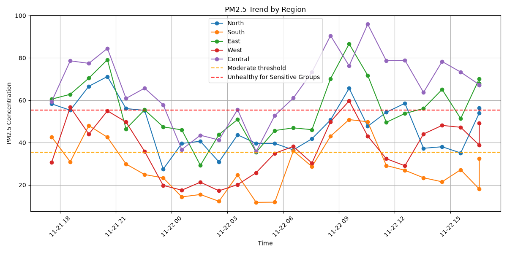
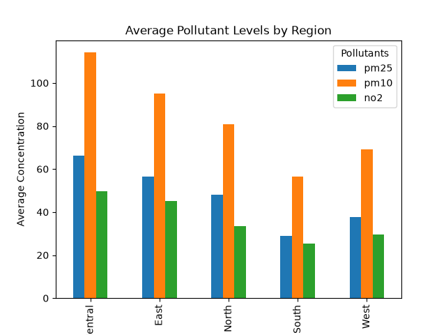
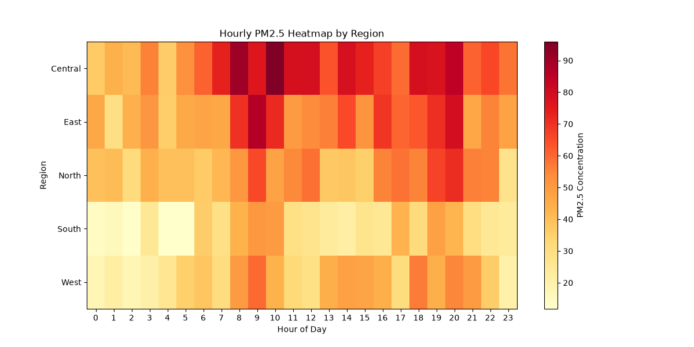

# Air Pollution Monitoring System

A Python-based air pollution monitoring system that simulates air quality data, stores pollution readings in a PostgreSQL database, analyzes pollutant levels, and visualizes air pollution trends across different regions.

## Features

- Simulates hourly air pollution data for five different regions.
- Stores pollution readings in a PostgreSQL database.
- Supports batch insertion of multiple readings.
- Retrieves historical pollution data.
- Calculates simplified Air Quality Index (AQI) categories based primarily on PM2.5 levels.
- Generates summary statistics for each region.
- Identifies the most polluted and cleanest regions based on average PM2.5 levels.
- Visualizes PM2.5 trends across regions.
- Compares average PM2.5, PM10, and NO2 concentrations across regions.
- Generates hourly PM2.5 heatmaps.

## Technologies Used

- **Python** – Main programming language.
- **PostgreSQL** – Relational database for storing pollution readings.
- **Pandas** – Data manipulation and analysis.
- **Matplotlib** – Data visualization and chart generation.
- **Psycopg2** – PostgreSQL database connectivity.
- **Python-dotenv** – Environment variable management.

## Project Structure

```text
air-pollution-monitoring-system/
│
├── module/
│   ├── database.py
│   ├── data_simulator.py
│   ├── analyzer.py
│   └── visualizer.py
│
├── test_connection.py
├── test_simulator.py
├── test_analyzer.py
├── test_aqi.py
├── test_summary.py
├── test_most_polluted.py
├── test_cleanest.py
├── test_visualizer.py
│
├── .env.example
├── .gitignore
├── requirements.txt
└── README.md
```

## Installation and Setup

### 1. Clone the repository

```bash
git clone https://github.com/Amineh-Omidpour/air-pollution-monitoring-system.git
cd air-pollution-monitoring-system
```

### 2. Create a virtual environment

```bash
python -m venv .venv
```

### 3. Activate the virtual environment

On Windows:

```bash
.venv\Scripts\activate
```

On Linux and macOS:

```bash
source .venv/bin/activate
```

### 4. Install dependencies

```bash
pip install -r requirements.txt
```

### 5. Configure environment variables

Create a `.env` file in the project root directory using `.env.example` as a template.

Update the database credentials in the `.env` file.

### 6. Create the PostgreSQL database

Create a PostgreSQL database named:

```text
pollution_db
```

Make sure PostgreSQL is running before executing the application.

## Running the Project

### 1. Generate simulated pollution data

Run the following command to generate 24 hours of simulated pollution readings:

```bash
python test_simulator.py
```

### 2. Analyze pollution data

Run the analyzer test script:

```bash
python test_analyzer.py
```

### 3. Generate visualizations

Run the visualization script:

```bash
python test_visualizer.py
```

The generated plots are saved in the `plots/` directory.

The project generates three types of visualizations:

- PM2.5 trends across different regions.
- Average pollutant levels comparison by region.
- Hourly PM2.5 heatmap.

## Testing

The project includes separate test scripts to verify database connectivity, data simulation, AQI calculation, statistical analysis, regional pollution analysis, and data visualization.

## Disclaimer

This project uses simulated air pollution data for educational and demonstration purposes. The AQI calculation is simplified and is based primarily on PM2.5 concentrations. The results should not be interpreted as real-time environmental measurements or official air quality assessments.

## Visualizations

### 1. PM2.5 Trend by Region



### 2. Average Pollutant Levels Comparison



### 3. Hourly PM2.5 Heatmap



## Kaggle Notebook

Explore the project overview, workflow, and visualizations in the Kaggle notebook:

[Air Pollution Monitoring System – Kaggle Notebook](https://www.kaggle.com/code/aminehomidpour/air-pollution-monitoring-system-data-engineering)
